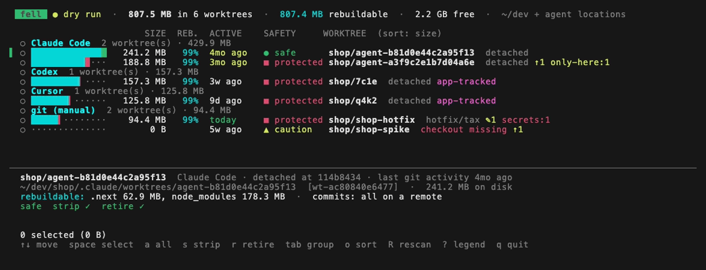
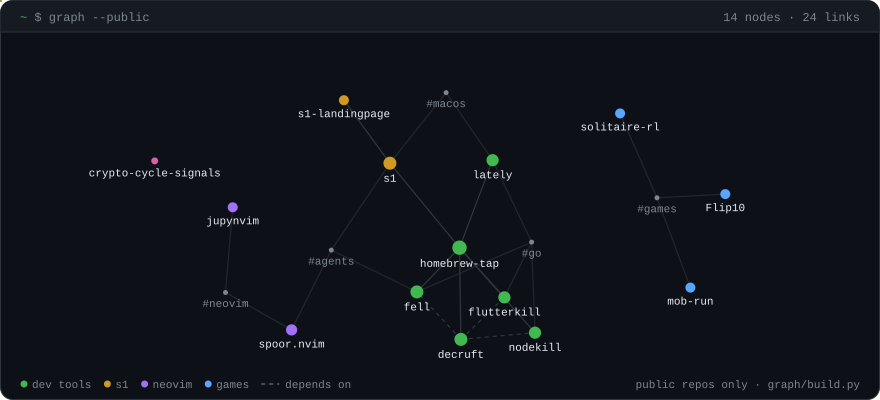

<picture>
  <source media="(prefers-color-scheme: dark)" srcset="assets/header-dark.svg">
  <source media="(prefers-color-scheme: light)" srcset="assets/header-light.svg">
  
</picture>

I build **agents** that act, **RL** that plays games, and **games** people actually play.
Day job: infra and AI agents for an education platform at [GeniusGrowthAI](https://geniusgrowth.ai).
Rule of thumb: keep it simple, measure it, ship it.

<picture>
  <source media="(prefers-color-scheme: dark)" srcset="assets/spotlight-dark.svg">
  <source media="(prefers-color-scheme: light)" srcset="assets/spotlight-light.svg">
  
</picture>

[**s1**](https://github.com/Matthew-Eucaristo/s1) · [**Mouse Maze Mayhem**](https://mouse-maze-mayhem-skripsi.web.app) · [**mob-run**](https://mob-run.pages.dev) · [**Flip10**](https://flip10.pages.dev) · [**solitaire-rl**](https://github.com/Matthew-Eucaristo/solitaire-rl) · [**crypto-cycle-signals**](https://github.com/Matthew-Eucaristo/crypto-cycle-signals)

<picture>
  <source media="(prefers-color-scheme: dark)" srcset="assets/shipped-dark.svg">
  <source media="(prefers-color-scheme: light)" srcset="assets/shipped-light.svg">
  
</picture>

### `$ ls ~/dev-tools`



Terminal tools for a developer's Mac, recorded on demo data ([tape](demo/tour.tape)). Evidence first, Trash by default, and every removal through the owning tool's own command.

```sh
brew install matthew-eucaristo/tap/{fell,flutterkill,nodekill,lately}
```

<details>
<summary>what each tool does</summary>
<br>

| tool | what it does | status |
| :-- | :-- | :-- |
| [**fell**](https://github.com/Matthew-Eucaristo/fell) | Finds git worktrees left behind by AI coding agents, shows the evidence, and cleans up without breaking the agent's own lifecycle. | v0.1.1 |
| [**flutterkill**](https://github.com/Matthew-Eucaristo/flutterkill) | npkill for Flutter: `build/`, `.dart_tool`, Pods and Gradle leftovers plus pub, Gradle, FVM and Xcode caches. | v0.2.0 |
| [**nodekill**](https://github.com/Matthew-Eucaristo/nodekill) | The Node.js footprint: `node_modules`, `.next` and framework caches, npm/pnpm/Yarn/Bun caches, npx, globals, old Node versions. | v0.1.0 |
| [**lately**](https://github.com/Matthew-Eucaristo/lately) | What just happened on my Mac? A classified timeline from the unified log, crash reports and persistence items, with a card per event. No root, no daemon. [Demo →](https://github.com/Matthew-Eucaristo/lately#readme) | v0.1.0 |
| **decruft** | One TUI over the cleaners. It reads each tool's `scan --json` and hands removal back to that tool. | planned |
| [**spoor.nvim**](https://github.com/Matthew-Eucaristo/spoor.nvim) | Follow the trail through a codebase in LazyVim: live call bow-tie, trace mode with notes, and what your agent changed. No AI, no index. [Demo →](https://github.com/Matthew-Eucaristo/spoor.nvim#readme) | v1.1.0 · lazy.nvim |
| [**jupynvim**](https://github.com/sheng-tse/jupynvim) | Jupyter notebooks in Neovim. I send fixes upstream: [HTML tables for pandas Styler](https://github.com/sheng-tse/jupynvim/pull/45), [docs](https://github.com/sheng-tse/jupynvim/pull/46). | upstream PRs |

</details>

### `$ graph --public`

<picture>
  <source media="(prefers-color-scheme: dark)" srcset="assets/graph-dark.svg">
  <source media="(prefers-color-scheme: light)" srcset="assets/graph-light.svg">
  
</picture>

<sub>Drawn by <a href="graph/build.py"><code>graph/build.py</code></a> on every change and once a week. It only draws repos the GitHub API reports as public. <a href="https://matthew-eucaristo.github.io/Matthew-Eucaristo/">Interactive version →</a></sub>

<details>
<summary><code>$ ls -l ~/projects</code> — every project, with its stack</summary>
<br>

| project | what it is | built with |
| :-- | :-- | :-- |
| [**s1**](https://github.com/Matthew-Eucaristo/s1) | Voice-first macOS agent. A fast local *System 1* acts; an LLM *System 2* is asked only when unsure. Every step gated and logged. [Site →](https://s1-mac.pages.dev) `brew install --cask matthew-eucaristo/tap/s1` | Swift 6 · AX API · ScreenCaptureKit |
| [**Mouse Maze Mayhem**](https://mouse-maze-mayhem-skripsi.web.app) | My thesis, playable. Four cats vs. one RL mouse in 3D mazes — a solver-distilled policy running in your browser via ONNX. | PyTorch · ONNX · React Three Fiber |
| [**solitaire-rl**](https://github.com/Matthew-Eucaristo/solitaire-rl) | Masked DQN and MaskablePPO learning Klondike, judged on a fixed 1000-deal benchmark. Honest result: the heuristic still wins. | Python · SB3 · Gymnasium |
| [**mob-run**](https://github.com/Matthew-Eucaristo/mob-run) | The game from those fake mobile ads, for real: a 3D crowd-runner where you pick multiplier gates and outgun mobs, walls and bosses across 5 zones. [Play →](https://mob-run.pages.dev) | Three.js |
| [**crypto-cycle-signals**](https://github.com/Matthew-Eucaristo/crypto-cycle-signals) | Futures indicator anchored to BTC's 4-year cycle; every parameter earned by backtest on 68 perps × 6 years. | Pine Script v6 |
| [**Flip10**](https://github.com/Matthew-Eucaristo/Flip10) | Shut the Box, polished: hand-drawn SVG tiles, procedural audio, fully offline. [Play →](https://flip10.pages.dev) | Next.js · TypeScript |

</details>

<details>
<summary><code>$ ls ~/archive</code> — game jam + university game lab</summary>
<br>

| build | stack |
| :-- | :-- |
| [Poppp: Rocket Balloon](https://github.com/Matthew-Eucaristo/GMTKGameJam2024) · [play](https://mammamiaaaaa.itch.io/pop-rocket-balloon) | Unreal Engine · GMTK Game Jam 2024 |
| [FOCUS tower defense](https://github.com/Matthew-Eucaristo/FOCUS-Game) · [play](https://syntax-gamedev.itch.io/focus-td) | Unreal Engine 5 |
| [Sliding puzzle](https://github.com/Matthew-Eucaristo/Sliding-Puzzle-UnrealEngine) | Unreal Engine 5 |
| [Shoot The Ghost AR](https://github.com/Matthew-Eucaristo/Shoot-The-Ghost-AR-KelasARVR) · [play](https://syntax-gamedev.itch.io/shoot-the-ghost-ar) | Unreal Engine · AR |
| [Computer graphics final](https://github.com/Matthew-Eucaristo/GrafKom-Final-Project) · [VR sim](https://syntax-gamedev.itch.io/compgraphsimvr) | Java · LWJGL / OpenGL |
| [Solar system](https://github.com/Matthew-Eucaristo/SolarSystemProject-Grafkom) | Java · LWJGL |
| [Guess the Path](https://github.com/Matthew-Eucaristo/Guess-the-Path) | Java · graphs |

</details>

### `$ ping matthew`

[LinkedIn](https://www.linkedin.com/in/matthew-eucaristo-265127184/) · [X](https://x.com/0xZexy) · [itch.io](https://syntax-gamedev.itch.io/) · [CV](https://mattheweuc.vercel.app/)

<sub>pytorch · stable-baselines3 · onnx · swift · typescript · react · three.js · go · bubble tea · lua · unreal engine · docker · cloudflare</sub>
